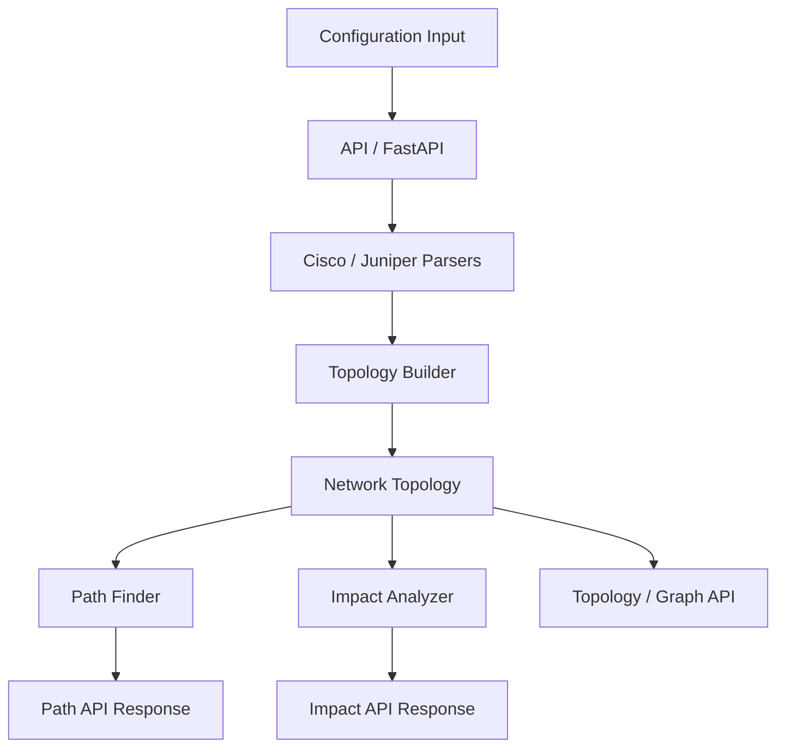

# Network Path Analyzer

Personal, company-neutral network engineering prototype. This repository contains no employer-specific material.

A prototype FastAPI service for ingesting Cisco- and Juniper-style device configurations, building a network topology, analyzing packet paths, and exploring configuration-change impact.

> **Project status:** Prototype / work in progress. The repository currently contains `main.py`, while the imported model, parser, and engine modules are not present in the visible repository tree. The application is therefore not yet runnable from a fresh clone.

## Goals

- Build a topology from supported network-device configurations.
- Explore devices, interfaces, routes, and discovered links.
- Calculate paths between source and destination IP addresses.
- Return topology graph data for visualization.
- Support batch path requests.
- Provide a starting point for configuration-change impact analysis.

## API capabilities in the current entry point

| Method | Endpoint | Purpose |
|---|---|---|
| GET | `/` | API welcome/version response |
| GET | `/api/v1/health` | Health and topology-loaded status |
| POST | `/api/v1/ingest` | Submit device configurations as JSON |
| POST | `/api/v1/ingest/upload` | Upload configuration files |
| GET | `/api/v1/topology` | Return topology details |
| GET | `/api/v1/devices` | List devices |
| GET | `/api/v1/devices/{device_name}` | Get device details |
| POST | `/api/v1/path` | Calculate a path |
| POST | `/api/v1/paths/batch` | Calculate multiple paths |
| POST | `/api/v1/impact` | Analyze configuration-change impact |
| GET | `/api/v1/links` | List topology links |
| GET | `/api/v1/graph` | Return graph nodes and edges |

## Architecture

The API entry point is `main.py` and is designed to coordinate these components:

- **Parsers:** Cisco and Juniper configuration parsing
- **Topology builder:** Build and validate the device/link topology
- **Path finder:** Calculate network paths
- **Impact analyzer:** Assess the potential impact of configuration changes
- **Models:** Represent topology and packet-path data

These imported components are not included in the current repository snapshot; this diagram reflects the intended structure, not a verified runtime architecture.



## Request examples

### Ingest configurations

```json
[
  {
    "hostname": "router-01",
    "device_type": "cisco_ios",
    "config_content": "..."
  }
]
```

### Request a path

```json
{
  "source_ip": "10.10.10.10",
  "destination_ip": "10.20.20.20",
  "protocol": "ip"
}
```

Optional source and destination ports are supported by the request model.

## Security notes

- Authentication credentials are read from environment variables: `NETWORK_ANALYZER_USERNAME` and `NETWORK_ANALYZER_PASSWORD`.
- Do not commit secrets, production device configurations, sensitive IP/addressing data, or customer topology details.
- Before deployment, restrict CORS to trusted origins, review which endpoints require authentication, use HTTPS, and add appropriate request/file validation and logging controls.
- Treat uploaded device configurations as sensitive data.

## Planned improvements

- Restore and publish the model, parser, and engine modules required by the API entry point.
- Add dependency manifests and documented setup instructions.
- Add sanitized sample configurations and automated tests.
- Add API authentication and authorization coverage for all sensitive endpoints.
- Restrict CORS and validate upload file size/type.
- Add topology and path visualization.
- Document parser coverage and limitations.

## Disclaimer

This project is an engineering prototype for learning and experimentation. Validate its output independently before using it to make changes to production networks.
